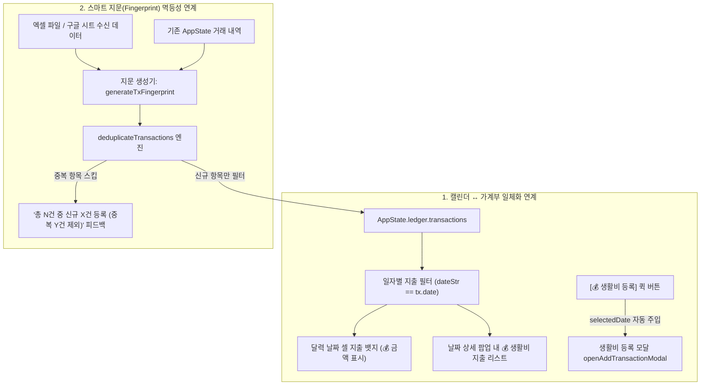

> [!NOTE]
> **Active SSOT - 확정 기준 계획서 (v2.2)**
> 본 문서는 '달콤살벌 캘린더' 가계부의 2대 데이터 연계 취약점(캘린더 날짜와의 미연결, 외부 시트 임포트 시 중복 데이터 발생)을 원천 해결하여, **캘린더 ↔ 가계부 일체화 바인딩** 및 **스마트 지문(Fingerprint) 기반 멱등성(Idempotency) 보장 엔진**을 구축하기 위한 정본 상세설계사양서입니다.

---

# 1. 배경 및 문제점 분석

### 1.1 현재 가계부 데이터 연계의 한계
1. **캘린더 날짜 ↔ 가계부 지출의 분리 (Silo)**:
   - 달력 날짜 셀([`renderCalendar`](file:///Users/yohan/couple-calendar/index.html))에는 음주, 일정, 쪽지만 표시되고 당일 발생한 지출 정보가 노출되지 않음.
   - 날짜 클릭 시 열리는 상세 모달([`openDayDetail`](file:///Users/yohan/couple-calendar/index.html))에서도 해당 일자의 생활비 지출 목록을 확인할 수 없고, 해당 일자로 생활비를 바로 등록하는 연계 동선이 부재함.
2. **외부 엑셀/구글 시트 연동 시 중복 데이터 누적 취약점**:
   - 엑셀 파일 업로드 또는 구글 스프레드시트 '🔄 지금 가져오기' 실행 시, 매번 `id: tx-${Date.now()}-${random}`을 새로 발급하여 무조건 `push()`함.
   - 사용자가 공유 시트 동기화를 여러 번 누르거나 같은 엑셀 파일을 다시 드롭하면 동일한 지출 내역이 N배로 중복 적재되어 통계와 잔여 예산을 심각하게 왜곡함.

---

# 2. 개선 아키텍처 및 시스템 흐름



---

# 3. 상세 기능 사양

### 3.1 캘린더 날짜 셀 지출 배지 표출
- **타겟 함수**: `renderCalendar()`
- **동작**:
  1. 각 날짜 셀 루프 시 `AppState.ledger.transactions`에서 해당 날짜(`dateStr`)의 `expense` 거래를 집계.
  2. 당일 지출이 존재하는 경우 `day-badges` 내에 지출 배지 렌더링:
     ```html
     <div class="badge-expense-wrapper" title="지출 2건 (45,000원)">
       <span class="badge-expense-icon">💰</span>
       <span class="badge-expense-amount">4.5만</span>
     </div>
     ```
  3. 금액 단축 포맷: 10,000원 이상은 소수점 1자리 '만' 단위(`4.5만`), 10,000원 미만은 콤마 표기(`8,000원`).

### 3.2 날짜 상세 모달(`openDayDetail`) 가계부 섹션 신설
- **마크업**: `#day-detail-modal` 내부에 `day-ledger-list` 컨테이너 추가.
- **동작**:
  1. 해당 날짜의 수입/지출 내역을 결제자 뱃지(주니/용이/공동), 카테고리, 금액(지출은 로즈레드 `-`, 수입은 블루 `+`), 메모와 함께 렌더링.
  2. 내역이 없을 경우 `"기록된 생활비가 없어요 ✨"` 안내.
  3. 모달 하단 액션 버튼에 `[💰 생활비 등록]` 버튼 추가 ➔ 클릭 시 `openAddTransactionModal()`을 열며 해당 날짜를 기본 세팅.
  4. 모달 내에서 개별 거래 즉시 삭제(`deleteTransactionFromDayDetail(id)`) 지원.

### 3.3 스마트 지문(Fingerprint) 기반 멱등성(Idempotency) 엔진
- **모듈**: `modules/excel_ledger_engine.js` 및 `index.html` 인라인 모듈.
- **인터페이스**:
  - `generateTxFingerprint(tx)`: `${date}|${amount}|${type}|${category}|${memo}` 규격화 문자열 반환.
  - `deduplicateTransactions(existingList, incomingList)`:
    - 반환값: `{ toAdd: Array, addedCount: number, skippedCount: number, total: number }`
- **적용처**:
  1. `syncSharedSpreadsheet()`: 구글 시트 웹 CSV 비동기 수신 시 멱등 적용.
  2. 엑셀/CSV 드래그앤드롭 파일 업로드 이벤트 핸들러.
  3. 토스트 알림: `"🎉 엑셀에서 총 15건 중 신규 12건 등록 완료 (중복 3건 제외)"`

---

# 4. 검증 계획
1. `tests/test_ledger_calendar_link.py`:
   - 캘린더 날짜 셀 지출 배지 및 금액 단축 포맷 검증.
   - 날짜 상세 모달 가계부 리스트 렌더링 및 삭제 인터페이스 검증.
   - 지문 생성 및 엑셀/CSV 중복 제거 멱등성 단위 테스트.
2. 기존 56개 단위/E2E 테스트 스위트 100% 회귀 통과 확인.
3. 배포본 및 옵시디언 vault 동기화.

