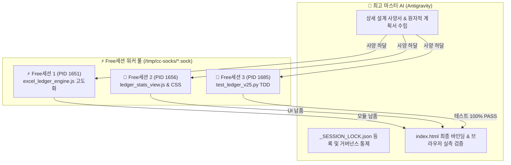

# [Active SSOT] 가계부 엑셀 연동 및 모바일/웹 듀얼 통계 고도화 상세 설계 사양서 (v2.5.0)

> [!IMPORTANT] **문서 상태: ACTIVE v2.5.0 (현재 시스템 적용 정본 설계 사양서)**  
> 본 문서는 부부 생활비 및 가계부 데이터의 엑셀 연동(업로드/공유 링크), CRUD, 고정비/예산 관리, 모바일/웹 반응형 듀얼 통계 고도화를 위한 마스터 AI 총괄 사양서입니다.  
> 본 작업은 **Free세션(Claude Code 워커 소켓) 최우선 할당 원칙**에 따라 분담 구현됩니다.

---

## 1. 배경 및 요구사항 정의

### 1.1 사용자 핵심 요구사항
1. **캘린더 & 일정/메모 연동**:
   - 기간 지정 일정 등록 및 일정별 메모 전달 (기존 v2.1~v2.4 구축 완료).
2. **엑셀 데이터 연동**:
   - 엑셀 파일(XLSX/CSV) 드래그앤드롭 업로드.
   - 공개된 공유 엑셀/구글 스프레드시트 링크 URL 연결 및 "지금 동기화" 기능.
3. **가계부 전체 CRUD 및 부가 기능**:
   - 거래 내역 등록/수정/삭제.
   - 카테고리별 태그 관리, 고정비 자동 등록, 엑셀 템플릿(양식) 다운로드 및 전체 내보내기.
4. **모바일 vs 웹 반응형 듀얼 통계**:
   - **모바일 화면**: 터치 최적화 카드 뷰, 부부 분담률(주니 vs 용이) 게이지, 카테고리별 랭킹 칩, 월별 지출 트렌드 미니 바 차트.
   - **웹 화면**: 대화면 피벗 테이블 (월별 x 카테고리 매트릭스), 일별 지출 추이 상세 라인 차트, 결제자/수단 상세 분석.

---

## 2. 모듈 아키텍처 및 WBS 역할 분담



---

## 3. 핵심 인터페이스 및 데이터 스키마

### 3.1 거래(Transaction) 객체 스키마
```typescript
interface LedgerTransaction {
  id: string;               // "tx-{timestamp}-{random}"
  date: string;             // "YYYY-MM-DD"
  type: 'income' | 'expense';
  category: string;         // '식비' | '카페' | '마트' | '주거' | '교통' | '의료' | '데이트' | '기타'
  amount: number;           // 정수 금액 (원)
  payer: 'juni' | 'yongi' | 'together';
  memo: string;             // 비고/적요
  isFixed?: boolean;        // 고정비 여부
  source?: 'manual' | 'excel_upload' | 'shared_link';
}
```

### 3.2 엑셀 연동 엔진 (`modules/excel_ledger_engine.js`) API
1. `parseExcelWorkbook(workbook)`: SheetJS 기반 XLSX 파싱 및 헤더 정규화.
2. `fetchSharedCsv(url)`: 공개 구글 시트 / 웹 CSV 비동기 패치.
3. `deduplicateTransactions(existingList, incomingList)`: 지문(Fingerprint) 기반 멱등성 보장 중복 제거.
4. `generateTemplateXlsx()`: 사용자가 바로 작성할 수 있는 표준 가계부 양식 XLSX 생성.
5. `exportToExcelData(transactions)`: 전체 거래 내역 엑셀 내보내기 2차원 배열 생성.

### 3.3 듀얼 통계 뷰 엔진 (`modules/ledger_stats_view.js`) API
1. `renderMobileStats(container, transactions, targetMonth, budget)`:
   - 이번 달 총지출 & 예산 잔여율 도넛 차트.
   - 주니 vs 용이 부부 분담 비율 카드.
   - Top 5 카테고리 지출 순위 칩.
   - 최근 6개월 월별 미니 바 차트.
2. `renderWebStats(container, transactions, targetMonth, budget)`:
   - 모바일 전체 컴포넌트 포함.
   - 대화면 월별 x 카테고리 교차 피벗 테이블(Pivot Matrix).
   - 일자별 누적 지출 상세 라인 추이.
   - 결제자별 세부 지출 테이블.

---

## 4. 검증 및 수용 기준 (Acceptance Criteria)

1. **엑셀 업로드 & 공유 링크**:
   - 샘플 XLSX 파일 업로드 시 즉시 가계부 목록에 반영되어야 함.
   - 중복 데이터 재업로드 시 중복 건수는 건너뛰고 신규 건수만 추가되어야 함.
2. **가계부 CRUD**:
   - 신규 거래 등록, 수정, 삭제가 즉시 UI 및 LocalStorage에 반영되고 0.05초 실시간 동기화로 브로드캐스트되어야 함.
3. **통계 화면 렌더링**:
   - 모바일 뷰포트(<=768px)에서는 모바일 맞춤형 카드/게이지가 렌더링되어야 함.
   - 웹 뷰포트(>768px)에서는 대화면 피벗 분석 테이블이 자연스럽게 확장 표출되어야 함.
4. **TDD 테스트**:
   - `tests/test_ledger_v25.py` 단위 테스트 100% 통과 (PASS).
   - 기존 전체 리그레션 테스트 (110개) 100% 통과 유지.

