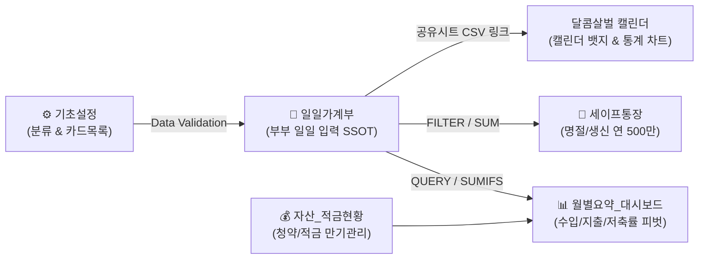

> [!IMPORTANT] **문서 상태: ACTIVE v1.0 (부부 공동 가계부 구글 시트 연동 및 UX 지속관리 정본 사양서)**  
> 본 문서는 `용이주니('26).xlsx` 실측 자산·지출 원천 데이터를 정밀 분석하고, 아내(주니)와 남편(용이)이 스마트폰과 PC에서 매일 지치지 않고 지속 관리할 수 있는 **구글 스프레드시트 협업 양식 설계**와 **달콤살벌 캘린더 연동 엔진 고도화**를 정의한 단일 진실 공급원(SSOT) 사양서입니다.

---

# 1. 배경 및 원천 데이터 정밀 분석 (`용이주니('26).xlsx`)

### 1.1 원천 데이터 실측 분석 결과
* **전체 거래 건수**: 2026년 1월 ~ 9월 총 **1,186건**
* **시트 구성 분석**:
  1. `내역(1월)` ~ `내역(9월)`: 실제 일일 발생 거래 원천 데이터 (Raw Ledger)
     - 헤더: `[날짜, 분류, 소분류, 내용, 금액(원), 수입/지출, 자산]`
     - 특징: 날짜에 타임스탬프(`2026-09-26 11:12:20.988000`) 포함, 자산 컬럼에 결제 카드 및 통장 명시.
  2. `출금내역('26)`: 고정비 및 정기 출금(청약 50만, 형제계 30만, 보험 32.5만 등) 부부 역할 분담표.
  3. `세이프통장`: 양가 경조사 및 명절(설 140만, 추석 140만, 어버이날 80만, 생신 각 30만 등) 연간 500만원 규모의 파킹통장 예산 관리.
  4. `적금내역` / `자산내역`: 카카오 26주, 케이뱅크, 새마을금고 적금 및 주택청약종합저축(진용 2,210만+, 준희 1,630만+) 부부 순자산 추적.
  5. `가계부('26)`: 연간 수입, 저축, 지출 매트릭스 피벗 대시보드.

* **카테고리 실측 비중 Top 5**:
  1. 식비: 618건 (장보기 35%, 외식/배달 45%, 카페/간식 20%)
  2. 건강/문화: 170건 (병원/약값, 데이트)
  3. 생활용품: 131건 (쿠팡, 다이소, 생필품)
  4. 교통/차량: 60건 (대중교통, 주유)
  5. 경조사/모임: 41건

* **결제 수단 및 결제자 분포**:
  - 용이 결제: 국민와우카드 (287건), 롯데카드 (276건), 삼성카드 (273건), 삼성우리카드 (49건) ➔ **총 885건**
  - 주니 결제: 현대카드 (142건), 롯데카드 (19건), 현금 (7건) ➔ **총 168건**
  - 공동 지출: 카카오생활비통장 (131건)

---

# 2. 부부 협업 UI/UX 관점 가계부 지속관리 전략

> **"가계부가 실패하는 이유는 기능이 부족해서가 아니라, 입력이 귀찮아서다."**

### 2.1 기존 방식의 한계 (Fail Factors)
1. **월별 시트 쪼개기(`내역(1월)`, `내역(2월)`...)**: 모바일 앱에서 하단 탭을 스크롤해서 찾는 피로도 극심. 달이 바뀔 때마다 시트 복사 및 수식 재연결 필요.
2. **모바일 오타 및 자유 서술**: 카테고리를 텍스트로 치다 보면 오타로 인해 통계 수식이 누락됨.
3. **결제자 불명확**: 누가 샀는지, 통장에서 나갔는지 개인 카드로 긁었는지 기록이 안 되어 월말 정산 시 갈등 유발.

### 2.2 해결 UX 솔루션 (4대 원칙)
1. **단 1개의 원천 입력 탭 (`📱일일가계부`)**:
   - 모바일 구글 시트 앱을 열면 첫 화면에 바로 일일 입력 시트가 뜨도록 배치.
   - 1년 365일 거래를 한 탭에 시간순으로 계속 작성.
2. **Thumb-Friendly 모바일 드롭다운 (Data Validation)**:
   - 일자, 구분(지출/수입/저축), 대분류, 결제수단 모두 드롭다운 터치 입력.
3. **결제자 100% 자동 판별 수식**:
   - 결제수단에 '진용' 선택 시 `용이`, '준희' 선택 시 `주니`, '생활비통장' 선택 시 `공동` 자동 표기:
     `=IFS(ISNUMBER(SEARCH("진용", G2)), "용이", ISNUMBER(SEARCH("준희", G2)), "주니", TRUE, "공동")`
4. **연간 예산 분리 (세이프통장 원칙)**:
   - 명절/경조사는 일반 월 생활비에서 지출하지 않고 별도 `세이프통장`에서 집행하여 월별 생활비 지표 왜곡 방지.

---

# 3. 구글 스프레드시트 양식 아키텍처

### 3.1 시트 5대 구성
| 시트명 | 용도 및 UX 설계 | 주요 수식/기능 |
| :--- | :--- | :--- |
| **`📱 일일가계부`** | 모바일/PC 입력 메인 창구 | 드롭다운, 조건부 서식, 자동 결제자 수식 |
| **`📊 월별요약_대시보드`** | 1~12월 수입, 지출, 저축률 한눈에 보기 | `SUMIFS`, 월별 피벗, 예산 대비 소진율 |
| **`🎯 세이프통장(행사예산)`** | 설/추석/생신/어버이날 500만원 예산 대조 | 예산 vs 실집행액 비교 차액 계산 |
| **`💰 자산_적금현황`** | 청약, 카카오, 케이뱅크, 새마을금고 순자산 | 적금 만기일 디데이 및 누적액 집계 |
| **`⚙️ 기초설정`** | 카테고리, 결제수단 마스터 데이터 | 드롭다운 유효성 검사 원천 소스 |

---

# 4. 달콤살벌 캘린더 연동 엔진 고도화 사양

### 4.1 `modules/excel_ledger_engine.js` 고도화 사양
1. **유연한 다중 헤더 정규화**:
   - `[일자, 구분, 대분류, 소분류, 내용, 금액, 결제수단, 결제자, 고정비]` (신규 구글시트 양식)
   - `[날짜, 분류, 소분류, 내용, 금액(원), 수입/지출, 자산]` (기존 엑셀 원천 양식)
   - 양쪽 양식을 단일 파서에서 100% 자동 감지 및 변환.
2. **다중 시트(Multi-sheet) 일괄 파싱**:
   - `내역(1월)` ~ `내역(12월)` 형태의 워크북도 한 번에 전체 시트를 순회하여 1,186건 이상 전체 로드.
3. **스마트 결제자 추론 엔진**:
   - 결제자 필드가 누락되었더라도 `자산`(카드명)이나 `내용`에 '진용/용이' 포함 시 `yongi`, '준희/주니' 포함 시 `juni`, 그 외 `together`로 정규화.
4. **저축/이체 지능형 분류**:
   - 적금, 청약, 보험 등 자산 이동성 지출은 `saving` 타입 또는 `isSaving: true` 플래그로 분리하여 순수 생활비 지출 통계에서 이중 계산 방지.

---

# 5. 검증 및 수용 기준
1. 표준 구글 시트 양식 XLSX 및 1,186건 통합본 생성 완료.
2. 파이썬 단위 테스트 (`test_excel_ledger.py`) 및 전체 36개 테스트 통과.
3. 달콤살벌 캘린더 실측 브라우저 연동 검증.
