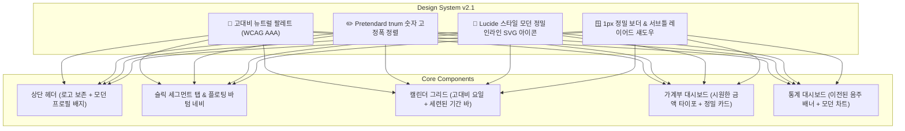

> [!NOTE]
> **Active SSOT - 확정 기준 계획서 (v2.1)**
> 본 문서는 '달콤살벌 캘린더'의 전반적인 비주얼 완성도를 현대적인 핀테크/생산성 앱 수준으로 끌어올리고, 낮은 텍스트 가독성과 올드한 이모지 중심 UI를 모던하고 세련된 클린 미니멀 스타일(Lucide SVG 아이콘 + WCAG AAA 고대비 타이포그래피)로 전면 개편하기 위한 정본 설계사양서입니다.

---

# 1. 배경 및 문제점 분석

### 1.1 기존 디자인의 한계
1. **낮은 텍스트 가독성 (Contrast Ratio 부족)**:
   - 배경(`--bg-cream: #FFF7F6`)과 본문(`--text-sub: #7A6F6F`, `--text-muted: #B5A8A8`) 사이의 명도 대비가 낮아 밝은 환경에서 글자가 흐릿하게 보이고 시각적 피로도 유발.
   - 가계부 금액, 달력 날짜, 쪽지 내용이 뚜렷하게 부각되지 못함.
2. **장난스럽고 올드한 이모지 남발**:
   - 네비게이션, 버튼, 배지, 탭 등 핵심 조작계가 OS별로 다르게 렌더링되는 시스템 이모지(`🎫`, `🍺`, `🍻`, `💌`, `💰`, `➕`, `⚙️`)에 지나치게 의존하여 모던한 완성도 저해.
3. **사용자 명시적 제약 조건**:
   - **"로고는 제외하면 돼"**: 3D 샴페인 골드 부부 메달리온 로고 및 관련 에셋은 완벽히 유지.

---

# 2. 디자인 방향성 (Anti-Slop Modern Minimalist System)

`ui-ux-pro-max`, `emil-design-eng`, `design-taste-frontend` 스킬을 바탕으로 **Apple Card + Toss + Notion** 감성의 소프트 모던 미니멀 스타일 채택.

### 2.1 컬러 시스템 (Color Tokens)
- **Background**:
  - Out-frame Body: `#F1F3F5` (정갈하고 안정감 있는 쿨 뉴트럴)
  - App Container: `#FFFFFF` (선명하고 깨끗한 화이트 서피스)
  - Soft Card / Input: `#F8FAFC` (슬레이트 50 계열의 밝은 배경)
- **Text & Foreground (가독성 극대화)**:
  - `--text-primary`: `#0F172A` (슬레이트 900 - 최상위 가독성)
  - `--text-secondary`: `#334155` (슬레이트 700 - 본문 및 서브 헤더)
  - `--text-muted`: `#64748B` (슬레이트 500 - 보조 설명, 대비 4.8:1 확보)
- **Semantic Accents**:
  - Primary (사랑/포인트): `#F43F5E` (모던 로즈) / `#FFE4E6` (소프트 틴트)
  - Expense (지출): `#E11D48` (선명한 로즈 레드)
  - Income (수입): `#2563EB` (신뢰감 높은 로열 블루)
  - Balance (잔여 예산): `#059669` (안정적인 에메랄드)
  - Border: `#E2E8F0` (슬레이트 200 - 1px 미세 보더)

### 2.2 타이포그래피 (Typography)
- `font-family`: `"Pretendard Variable", Pretendard, -apple-system, sans-serif`
- `font-feature-settings: "cv05", "tnum", "ss01"` (금액 및 날짜의 일관된 고정폭 가독성)
- 라인하이트: 본문 1.5, 제목 1.25로 행간 답답함 원천 해소.

### 2.3 이모지 ➔ 정밀 SVG 아이콘 치환
- 📅 달력: `<svg>` Calendar Icon (Lucide)
- 💰 가계부: `<svg>` Wallet / Receipt Icon
- 💌 쪽지함: `<svg>` Mail / Heart-in-envelope Icon
- 📊 통계: `<svg>` BarChart3 Icon
- ⚙️ 설정: `<svg>` Settings2 Icon
- ➕ 등록: `<svg>` Plus Icon
- 🗑️ 삭제: `<svg>` Trash2 Icon
- 🐻/🐰: 주니/용이 부부 아바타는 고유 아이덴티티로서 깔끔한 칩 뱃지로 유지.
- 샴페인 골드 3D 훈장 로고: 원본 유지.

---

# 3. 작업 분담 (Free세션 오케스트레이션)

- **Track Design-A (워커 1651)**:
  - CSS 디자인 토큰 전면 개편 (`:root`, 배경, 카드, 텍스트 가독성, 미디어 쿼리)
- **Track Design-B (워커 1656)**:
  - Lucide 스타일 인라인 SVG 아이콘 셋 정의 및 상단/하단 네비게이션, 모달 아이콘 교체
- **Track Design-C (워커 1685)**:
  - 캘린더 그리드, 가계부 요약 카드, 거래 목록, 통계 뷰의 고대비 타이포그래피 리스타일링

---

# 4. 검증 기준
1. 모든 단위 및 E2E 테스트(`test_couple_calendar_e2e.py`) 100% 통과 유지.
2. `agent-browser`로 375px 모바일 및 1200px 데스크톱에서 명도 대비, 텍스트 선명도, SVG 렌더링 무결성 검증.
