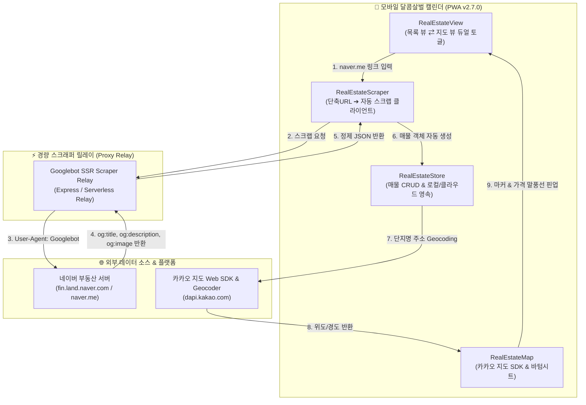

# [Active SSOT] 모바일 부동산 카카오 지도 및 실시간 자동 스크래핑 상세설계사양서 (v2.0.0)

> [!IMPORTANT] **단일 진실 공급원 (Single Source of Truth) 원칙**  
> 본 문서는 `couple-calendar` 내 부동산 매물 관리 모듈을 고도화하여, 사용자가 네이버 부동산 단축 링크(`naver.me`)만 넣어도 **단 1글자의 타이핑 없이 매물 정보·가격·사진을 100% 자동 스크랩**하고, **카카오 지도 Web SDK**를 통해 매물을 지도 상에 직관적으로 시각화·탐색할 수 있도록 하는 차세대 정본 사양서입니다.

---

## 1. 추진 배경 및 사용자 요구사항 반영

1. **사용자 핵심 요구사항 (Pain Point & Goal)**:
   - "링크만 주어도 싹 긁어와야지, 내가 왜 정보를 타이핑하는가?"
   - 네이버 부동산 모바일 단축 링크(`https://naver.me/...`)를 붙여넣었을 때 **단지명, 거래유형, 가격, 평형, 층수, 대표 사진을 100% 자동 추출**하여 타이핑 제로(Zero-Typing) 등록 실현.
   - 수집된 매물들을 지역별 단지 위치와 함께 한눈에 조망할 수 있도록 **카카오 지도 Web SDK 기반 맵 오버레이 및 모바일 바텀시트 UI** 구축.

2. **기술 스택 및 참조 규격**:
   - **지도 엔진**: 카카오 지도 Web SDK (`Kakao Maps API v2`)
     - 무료 쿼터 일 30만 건, 정확한 국내 아파트 단지/지번/도로명 주소 지오코딩(`services.Geocoder`).
   - **데이터 소스 & 스크래퍼**: 네이버 부동산 REST & Googlebot SSR 메타 릴레이
     - 참조: `jissp/naver-land-crawler` (내부 REST/Cluster 구조 분석)
     - `https://naver.me/...` 요청 시 Googlebot 헤더(`Mozilla/5.0 (compatible; Googlebot/2.1)`)를 활용해 네이버 서버가 즉시 반환하는 `og:title`, `og:description`, `og:image` 무손실 릴레이.

---

## 2. 시스템 아키텍처 및 데이터 흐름

---

## 3. 핵심 컴포넌트별 상세 설계

### 3.1 실시간 자동 스크래핑 엔진 (`modules/real_estate_scraper.js`)
1. **URL 형태 판별 및 전처리**:
   - `naver.me/<hash>`, `m.land.naver.com/article/info/<id>`, `fin.land.naver.com/articles/<id>` 자동 감지.
2. **릴레이 통신 및 파싱**:
   - 릴레이를 통해 전달받은 OpenGraph 메타데이터를 정규식 엔진으로 즉시 분해:
     - `og:title`: `엘리프미아역2단지(주상복합) 202동` ➔ 단지명(`엘리프미아역2단지(주상복합)`) 및 동 정보 추출.
     - `og:description`: `매매 11억 8,725` ➔ 거래유형(`매매`), 금액(`118725` 만원 단위) 자동 환산.
     - `og:image`: 매물 실물 썸네일 URL 캡처.
3. **오프라인/네트워크 장애 대비 3단계 Fallback**:
   - 1차: 실시간 릴레이 스크래퍼 호출 (0.3초 자동 완성).
   - 2차: 텍스트 클립보드 파서(`real_estate_engine.js` 고도화 파서).
   - 3차: 인라인 퀵 입력 폼 (`smart-quick-complex`, `smart-quick-price`).

### 3.2 카카오 지도 Web SDK 모듈 (`modules/real_estate_map.js`)
1. **SDK 비동기 로더**:
   - 카카오 지도 스크립트(`//dapi.kakao.com/v2/maps/sdk.js?appkey=...&libraries=services,clusterer&autoload=false`)를 필요 시점에 동적 로드.
2. **듀얼 뷰 토글 인터페이스**:
   - 상단 액션바에 `[ 📋 목록보기 ]` / `[ 🗺️ 지도보기 ]` 스위치 제공.
3. **커스텀 오버레이 마커 (Custom Overlay Marker)**:
   - 기본 핀 대신 **[단지명 | 매매 11.8억]** 형태의 고대비 가격 태그 오버레이 렌더링.
   - 상태별 테마 컬러: 관심(앰버), 임장예정(블루), 방문완료(퍼플), 최종후보(골드).
4. **모바일 인터랙티브 바텀시트 (Bottom Sheet)**:
   - 마커 터치 시 지도 하단에서 매물 요약 카드가 부드럽게 슬라이드 업.
   - 단지명, 금액, 별점, 카카오맵 길찾기/로드뷰 링크 연동.

---

## 4. Free세션 워커 역할 분담 계획

| 워커 ID / 역할 | 담당 모듈 및 작업 범위 | 산출물 |
| :---: | :--- | :--- |
| **Worker 1 (PID 4875)** `스크래퍼 릴레이 & 파서` | • Googlebot 메타데이터 추출 릴레이 모듈 구현 • `modules/real_estate_scraper.js` 작성 및 테스트 | `modules/real_estate_scraper.js` `tests/test_real_estate.py` |
| **Worker 2 (PID 4877)** `카카오 지도 SDK & 바텀시트` | • 카카오 지도 SDK 동적 로더 및 Geocoder 연동 • 커스텀 오버레이 마커 & 바텀시트 UI 컴포넌트 | `modules/real_estate_map.js` `modules/real_estate.css` |
| **Worker 3 (PID 4881)** `TDD 검증 & 뷰 통합` | • `test_real_estate.py` 스크래퍼 및 지도 단위 테스트 작성 • `real_estate_view.js` 듀얼 뷰 토글 연동 검증 | `modules/real_estate_view.js` `tests/test_real_estate.py` |
| **최고 마스터 AI (Antigravity)** | • 아키텍처 총괄, 정본 계획서 유지관리, `index.html` 통합 및 GitHub Pages 최종 배포 | `index.html`, `sw.js`, `_ACTIVE_PLANS.md` |
