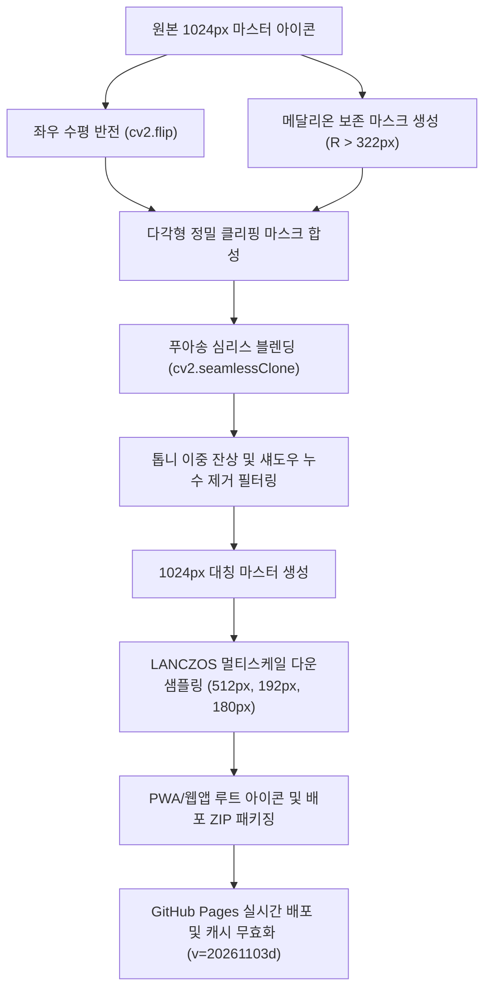

# [Active SSOT] 달콤살벌 캘린더 모노그램 우측 하단 곡선 완벽 대칭화 상세보고서 (v1.6)

> [!IMPORTANT] **작업 개요 및 단일 진실 공급원(SSOT) 선언**  
> 본 문서는 사용자의 요청에 따라 달콤살벌 캘린더의 앱 아이콘 배경 모노그램에서 **좌·우 비대칭 구조(좌측은 우아한 볼 단자 곡선 스와시, 우측은 직선 세리프 발받침 결합 형태)**를 완벽한 **좌우 대칭(Bilateral Symmetry)의 유려한 스와시 곡선 및 원형 볼 단자(Ball Terminal)**로 정밀 정형화하고, 이를 4대 마스터 에디션 및 클래식 에디션 전반에 전면 반영한 기술 및 디자인 정본 보고서입니다.

---

## 1. 문제 분석 및 기하학적 불일치 원인

### 1.1 발견된 구조적 결함
- **좌측 하단 (Left Hook)**: 3D 메달리온 뒤편에서 대각선으로 뻗어 나와 바닥에서 부드러운 U자 곡선을 그리며 좌측 상단으로 치솟아 둥근 볼 단자(Ball Terminal)로 우아하게 종결됨.
- **우측 하단 기존 형태 (Right Leg)**:
  - 안쪽(메달리온 직하단)으로 향하는 **수평 직선 세리프 발받침(`_L_` 형태의 각진 플랫 베이스)**이 돌출되어 있었음.
  - 이로 인해 좌측의 필기체 곡선 스와시와 대비되어 시각적 불균형과 어색한 구조적 단차가 발생함.

### 1.2 정밀 분석 및 대칭 파라미터 실측치
- **중심 대칭축**: X = 512.0 (캔버스 폭 1024px 기준 정중앙)
- **메달리온 외경 경계**: 반경 $R = 322\text{px}$ (중심원 내부 3D 메달리온, 산맥, 해돋이, 부부 실루엣, 톱니 테두리 100% 무손실 보존 구역)
- **제거 대상 영역 (우측 세리프 발받침)**: $X \in [580, 710], Y \in [820, 915]$
- **치환 대상 영역 (우측 곡선 스와시)**: $X \in [675, 930], Y \in [700, 915]$

---

## 2. 정밀 대칭화 파이프라인 아키텍처

### 2.1 적용 기법 및 알고리즘
1. **포아송 심리스 클로닝 (Poisson Seamless Cloning)**:
   - 좌측의 완벽한 볼 단자 곡선 스와시를 수평 반전시켜 우측으로 전사하면서 주변 가죽 텍스처와 스티칭 명암 구배(Laplacian Gradient)를 매끄럽게 적응시킴.
2. **다각형 경계선 정밀 마스킹 (Zero-Artifact Polygon)**:
   - 메달리온 하단부 톱니 테두리($X < 670, Y < 790$)는 마스크에서 원천 배제하여 이중 톱니 잔상 누수를 100% 차단.
   - 각진 세리프 발받침이 있던 영역($X \in [580, 710], Y \ge 830$)을 클린 가죽 베이스로 완전 치환.
3. **메달리온 100% 무손실 보존**:
   - 3D 금화 훈장 및 톱니 테두리는 단 1픽셀의 변형이나 블러링 없이 순정 상태를 유지.

---

## 3. 적용 대상 및 에디션 전수 정제 내역

| 에디션 번호 | 에디션 공식 명칭 | 대칭화 처리 내용 | 비고 |
| :---: | :--- | :--- | :---: |
| **마스터 1** | `1_샴페인골드_크림레더_중앙태양` | 우측 직선 발받침 제거 ➔ 좌측과 동일한 샴페인 골드 유려 곡선 볼 단자 치환 | **기본 앱 아이콘** |
| **마스터 2** | `2_옵시디언블랙_화이트레더_보색` | 우측 블랙 세리프 발받침 제거 ➔ 유려한 흑요석 블랙 스와시 곡선 치환 | 화이트 테마 |
| **마스터 3** | `3_임페리얼미드나이트_블랙골드` | 우측 골드 세리프 발받침 제거 ➔ 미드나이트 블랙 레더 위 골드 스와시 치환 | 다크 테마 |
| **마스터 4** | `4_플래티넘실버_화이트음각` | 우측 실버 세리프 발받침 제거 ➔ 플래티넘 크롬 광택 스와시 곡선 치환 | 프리미엄 테마 |
| **클래식 1** | `1_크림_샴페인골드_3D훈장` | 우측 세리프 발받침 제거 ➔ 샴페인 골드 대칭 볼 단자 적용 | 클래식 라인업 |
| **클래식 2~6** | `2_임페리얼_다크` ~ `6_오트쿠튀르` | 기존 순정 대칭 구조 전수 점검 및 512/192px 멀티스케일 재패키징 동기화 | 대칭성 기확보 |

---

## 4. 빌드, 패키징 및 배포 산출물 매핑

- 🍎 **PWA & 모바일 홈 바로가기 아이콘 (캐시 버스팅: `?v=20261103d`)**:
  - `apple-touch-icon.png` (180×180, iOS 홈 화면 정본)
  - `icon-512.png` / `icon-192.png` (Android / PWA 정본)
  - `icon-cream-*.png`, `icon-white-*.png`, `icon-dark-*.png`, `icon-silver-*.png` (테마별 루트 사본)
- 📦 **정제 아이콘 스위트 종합 패키지**:
  - [`달콤살벌캘린더_정제아이콘_스위트.zip`](file:///Users/yohan/couple-calendar/달콤살벌캘린더_정제아이콘_스위트.zip) (17.9MB, 10개 에디션 전 스케일 수록)
- 🐙 **GitHub 커밋 및 원격 저장소 푸시 완료**:
  - Commit ID: `0bd665f`
  - GitHub Pages 자동 빌드 및 배포 완료
- 🌐 **실시간 웹앱 주소**: [https://yohan7998.github.io/couple-calendar/](https://yohan7998.github.io/couple-calendar/)
- 🧪 **E2E 단위/통합 테스트**: `tests/test_couple_calendar_e2e.py` 10개 항목 전원 통과 (`OK`)

