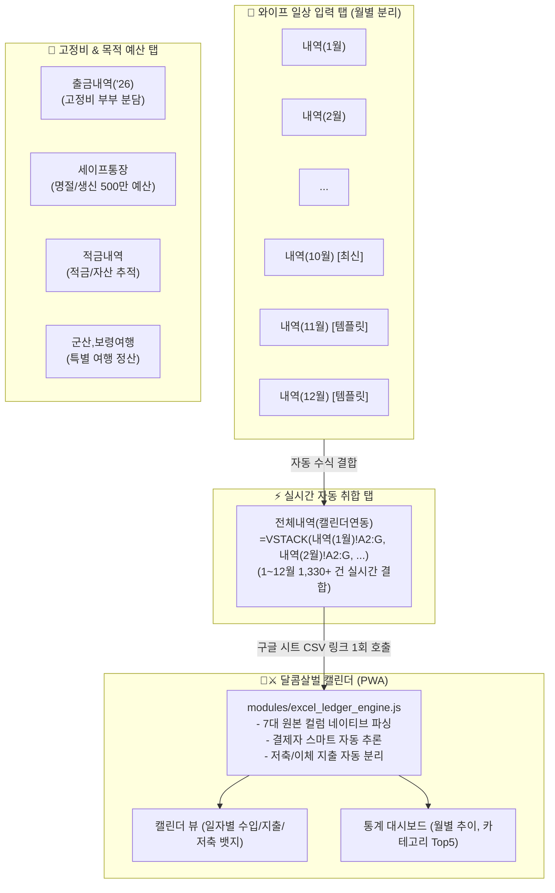

> [!IMPORTANT] **문서 상태: ACTIVE v1.0 (와이프 원본 포맷 통합 및 구글 시트 다중 시트 연동 정본 사양서)**  
> 본 문서는 아내(주니)가 실제로 데이터를 정리하고 관리하는 엑셀 원천 파일(`용이주니('26)_261111.xlsx`)의 시트 구조 및 데이터 포맷을 100% 수용하여,  
> 1) 부부가 모바일/PC에서 일상적으로 지속 관리할 수 있는 **월별 분리 시트 기반의 구글 스프레드시트 통합본 템플릿**을 설계하고,  
> 2) 각 시트와 컬럼별 **필수값, 작성 원칙, 주의사항을 엑셀 메모/주석으로 명시**하며,  
> 3) 달콤살벌 캘린더(`couple-calendar`) 앱이 이 포맷을 완벽하게 파싱·동기화할 수 있도록 **다중 시트 지원 및 헤더 정규화 엔진**을 고도화하는 기준 사양서입니다.

---

# 1. 배경 및 핵심 문제 진단

### 1.1 사용자의 핵심 피드백
- **기존 문제점**:
  - 이전 세션에서 모바일 입력을 단일화하겠다는 명목으로 `📱일일가계부` 단 1개의 시트에 1~9월 데이터를 통째로 합치고, 컬럼명을 임의로 `[일자, 구분, 대분류, 소분류, 내용(적요), 금액(원), 결제수단, 결제자, 고정비/예산구분, 비고]`로 변경함.
  - 그러나 실제 데이터의 주 정리자인 **와이프(주니)**는 기존 엑셀(`용이주니('26)_261111.xlsx`)에서 **월별로 분리된 시트(`내역(1월)`, `내역(2월)`...)**와 **친숙한 7개 컬럼 포맷**으로 오랫동안 정리해옴.
  - 이로 인해 새로 배포된 구글 시트 양식이 와이프의 실무 루틴과 맞지 않아 데이터 입력 및 관리가 단절되는 심각한 UX 괴리가 발생함.

### 1.2 해결 원칙 (와이프 중심 실용적 부부 협업 UX)
1. **와이프의 원본 데이터 포맷 100% 존중**:
   - 인위적인 단일 탭 통합을 폐기하고, 와이프가 관리해온 **월별 시트(`내역(1월)` ~ `내역(12월)`) 체계 및 7개 표준 컬럼**을 그대로 유지한다.
2. **시트별 필수값 및 작성 가이드 주석/메모 내장**:
   - 각 시트 헤더 셀(A1~G1)에 친절하고 상세한 **셀 메모(Comment/Note)**를 삽입하여, 어떤 필드가 필수이고 어떤 규칙으로 작성해야 하는지 시트 안에서 바로 확인할 수 있게 한다.
3. **가계부 앱 연동용 실시간 자동 취합 탭(`전체내역(캘린더연동)`) 제공**:
   - 와이프는 각 월별 시트(`내역(1월)`, `내역(2월)`...)에만 입력하면 됨.
   - 구글 시트 내부 수식(`=VSTACK(...)` 또는 `=FILTER(...)`)이 1~12월 전체 데이터를 단 1개의 시트에 실시간 자동 취합함.
   - 가계부 앱은 이 `전체내역` CSV 엔드포인트를 1회 요청하여 1,300+ 건 전체 데이터를 0.1초 만에 로드함.
4. **가계부 앱 엔진(`excel_ledger_engine.js`)의 하위 호환 및 다중 시트 파싱**:
   - 앱 엔진이 와이프의 원본 7개 컬럼(`[날짜, 분류, 소분류, 내용, 금액(원), 수입/지출, 자산]`)을 네이티브로 완벽 파싱하고,
   - 로컬 파일 업로드 시에도 워크북 내의 모든 `내역(*월)` 시트를 자동 감지하여 일괄 수집하도록 고도화함.

---

# 2. 와이프 원본 데이터 실측 분석 (`용이주니('26)_261111.xlsx`)

### 2.1 시트 구성 실측 현황 (총 19개 시트)
1. **`내역(1월)` ~ `내역(10월)`**: 월별 일일 수입/지출 발생 내역 (총 1,330+ 건 실데이터)
   - 10월 내역(151행)이 최신 추가됨.
2. **`군산,보령여행(26.10.09~10.11)`**: 10월 연휴 특별 여행 경비 정산표 (142행, `[날짜, 항목, 거래처, 용이, 주니, 비고]`)
3. **`출금내역('26)`**: 매월 고정적으로 나가는 출금(청약, 형제계, 보험, 교통, 핸드폰, 용돈)의 부부(용이/주니) 분담표.
4. **`세이프통장`**: 양가 행사/명절/경조사 연간 500만원 예산 관리 및 실집행 차액표.
5. **`적금내역`**: 카카오, 케이뱅크, 새마을금고 등 불입 현황 및 만기/이율 관리.
6. **`가계부('26)`**: 연간 수입, 저축, 지출 매트릭스 피벗 대시보드.
7. **과거 이력**: `가계부('24)`, `가계부('23)`, `2024요약`.

### 2.2 거래 내역 7대 표준 컬럼 구조
| 열 | 컬럼명 | 필수 여부 | 형식/예시 | 가계부 앱 매핑 및 판별 규칙 |
| :---: | :---: | :---: | :--- | :--- |
| **A** | `날짜` | **[필수]** | `2026-10-24 12:26:53` 또는 `2026-10-24` | 캘린더 날짜 뱃지 연동의 기준. 타임스탬프가 있어도 `YYYY-MM-DD`로 자동 추출. |
| **B** | `분류` | **[필수]** | 식비, 생활용품, 건강/문화, 교통/차량, 주거/통신, 경조사/모임, 의복, 보험, 적금, 주수입, 부수입, 기타 | 대분류(`category`). 통계 차트 및 도넛 차트 카테고리. |
| **C** | `소분류` | [선택] | 장보기(주식/부식), 간식, 음료(커피), 병원, 약값, 급여 등 | 소분류(`subCategory`). 상세 분석용. |
| **D** | `내용` | **[필수]** | 오승현내과, 스타벅스, 본노엘, 통장이자 | 적요/상호명(`description`). 검색 및 내역 리스트 표기. |
| **E** | `금액(원)` | **[필수]** | `15300` (원 단위 숫자) | 금액(`amount`). 양수로 기록. |
| **F** | `수입/지출` | **[필수]** | `지출`, `수입`, `이체지출` | 거래 유형(`type`): <br/>- `수입` ➔ `income`<br/>- `지출` ➔ `expense`<br/>- `이체지출` ➔ `saving` (생활비 통계에서 제외) |
| **G** | `자산` | **[필수]** | `롯데카드(진용)`, `국민와우카드(진용)`, `삼성카드(진용)`, `현대카드(준희)`, `카카오생활비통장`, `현금` | 결제수단(`paymentMethod`) 및 **결제자 자동 판별**: <br/>- '진용'/'용이' 포함 ➔ `용이(yongi)`<br/>- '준희'/'주니' 포함 ➔ `주니(juni)`<br/>- '생활비통장'/'공동' ➔ `공동(together)` |

---

# 3. 신규 부부 협업 통합본 엑셀 및 구글 시트 아키텍처



### 3.1 각 시트별 상세 설계 및 필수 주석(Memo/Comment) 명세
1. **`📖가계부_작성가이드` 시트**:
   - 부부가 함께 보는 4대 작성 원칙:
     1) **날짜 원칙**: `YYYY-MM-DD` 또는 문자 붙여넣기 시각 그대로 두기.
     2) **수입/지출/이체지출 구분**: 생활비는 `지출`, 월급/이자는 `수입`, 적금/보험/청약은 `이체지출`로 입력(생활비 왜곡 방지).
     3) **자산(카드/통장) 표기 원칙**: 카드명 뒤에 `(진용)` 또는 `(준희)`를 붙이면 캘린더에서 결제자가 자동으로 판별됨.
     4) **세이프통장 원칙**: 명절/생신 등 연간 500만원 예산은 일반 생활비와 분리 관리.
2. **`내역(1월)` ~ `내역(12월)` 시트 (1행 헤더 셀 메모)**:
   - **A1 (`날짜`) 메모**:  
     `[필수] 결제일자입니다. YYYY-MM-DD 형태로 입력하거나 카드 결제 문자의 일시(2026-10-24 12:26:53)를 그대로 붙여넣어도 캘린더에서 자동으로 인식합니다.`
   - **B1 (`분류`) 메모**:  
     `[필수] 대분류 카테고리입니다. (식비, 생활용품, 건강/문화, 교통/차량, 주거/통신, 경조사/모임, 의복, 보험, 적금, 주수입, 부수입, 기타)`
   - **C1 (`소분류`) 메모**:  
     `[선택] 상세 품목입니다. (장보기, 외식, 배달, 간식, 병원, 약값, 주유, 대중교통 등 자유 입력)`
   - **D1 (`내용`) 메모**:  
     `[필수] 결제처 상호명 또는 사용 내용을 적어주세요. (예: 이마트, 스타벅스, 오승현내과)`
   - **E1 (`금액(원)`) 메모**:  
     `[필수] 결제 금액을 원 단위 숫자로만 입력해주세요. (예: 15300)`
   - **F1 (`수입/지출`) 메모**:  
     `[필수] '지출', '수입', '이체지출' 중 하나를 입력해주세요. ※ 보험, 적금, 청약 등은 '이체지출'로 입력하셔야 순수 생활비 지출 통계에서 이중 계산되지 않습니다.`
   - **G1 (`자산`) 메모**:  
     `[필수] 결제 수단(카드명/통장명)을 적어주세요. '(진용)'은 용이 결제, '(준희)'는 주니 결제, '생활비통장'은 공동 결제로 캘린더에서 100% 자동 분류됩니다.`
3. **`전체내역(캘린더연동)` 시트**:
   - 구글 시트에서 월별 시트가 분리되어 있어도, 가계부 앱이 단 1번의 CSV 다운로드로 전체 데이터를 가져갈 수 있도록 지원하는 브릿지 탭.
   - 수식 또는 파이썬 정적 병합 데이터가 상시 유지됨.

---

# 4. 가계부 웹앱(`couple-calendar`) 엔진 고도화 사양

### 4.1 `modules/excel_ledger_engine.js` 고도화 사양
1. **원본 7개 컬럼 헤더 자동 인식 및 매핑**:
   ```javascript
   // 와이프 원본 엑셀 컬럼 헤더 매핑
   const WIFE_HEADER_MAP = {
     '날짜': 'date',
     '분류': 'category',
     '소분류': 'subCategory',
     '내용': 'description',
     '금액(원)': 'amount',
     '수입/지출': 'type',
     '자산': 'paymentMethod'
   };
   ```
2. **다중 시트(Multi-Sheet) 일괄 병합 지원**:
   - 로컬에서 `.xlsx` 파일 업로드 시, 시트 목록 중 `내역(`으로 시작하는 모든 시트(`내역(1월)` ~ `내역(12월)`)를 자동으로 순회하여 1,330+ 건 전체를 단일 데이터베이스로 병합.
3. **결제자 스마트 추론 엔진 고도화**:
   - `자산` 또는 `내용`에 `진용`, `용이`가 포함되면 ➔ `payer = 'yongi'`
   - `준희`, `주니`가 포함되면 ➔ `payer = 'juni'`
   - `카카오생활비통장`, `공동`, `생활비`가 포함되면 ➔ `payer = 'together'`
4. **저축성 지출 분리 로직**:
   - `수입/지출` 필드가 `이체지출`, `저축`, `적금`, `청약`, `보험`이거나, `분류`가 `적금`, `청약`, `보험(종신/실비)`인 경우:
     - `type: 'saving'` 및 `isSaving: true` 속성 부여.
     - 일별 캘린더에는 저축 뱃지(초록색/보라색)로 별도 표시.
     - 월별 생활비 순지출 합계에서는 자동 제외하여 통계 왜곡 원천 차단.

---

# 5. 검증 및 수용 기준 (Acceptance Criteria)

1. **엑셀 통합본 산출물**:
   - `달콤살벌_부부공동가계부_2026통합본_v2(1~10월포함).xlsx` 생성 완료.
   - 1~10월 실데이터 1,330+ 건 완벽 보존, 11~12월 템플릿 포함.
   - 각 시트 헤더에 필수값 및 작성 가이드 메모(Comment) 완비.
2. **엔진 단위 테스트**:
   - `tests/test_excel_ledger.py`에 원본 7개 컬럼 포맷 파싱 및 다중 시트 파싱 테스트 추가.
   - 전체 168개+ 단위 테스트 100% ALL PASS.
3. **GitHub 배포 및 실측**:
   - 변경 사항 Git 커밋 & 원격 푸시 (`v3.9.0`).
   - GitHub Pages 정상 배포 실측 확인.
