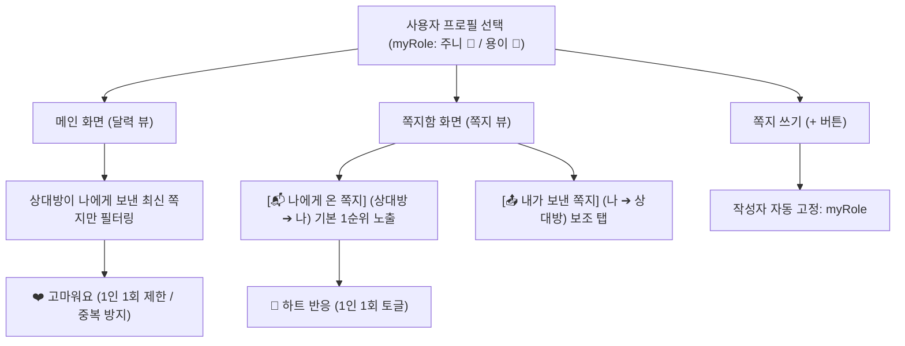

# 달콤살벌 캘린더 쪽지 개인화 및 하트 단일 반응 상세 설계 사양서 (v1.8.0)

> [!IMPORTANT] **설계 방향성 및 핵심 목적**  
> 사용자가 누구인지(`myRole`: 주니 또는 용이)를 선택했을 때, **1) 메인 화면에는 상대방이 보낸 최신 쪽지만 노출되어 즉시 확인 가능**하고, **2) 쪽지함은 나에게 온 쪽지(수신함)가 1순위 메인으로 자동 정렬**되며, **3) 하트 반응은 메시지당 1회로 엄격히 제한**되어 중복 누적을 방지하는 부부 맞춤형 프라이빗 UX를 완성합니다.

---

## 1. 요구사항 분석 및 해결 아키텍처



### 1.1 메인 화면 상대방 쪽지 필터링
- 메인 달력 상단의 `latest-note-alert-card`는 현재 선택된 사용자(`myRole`)의 **배우자(`spouseRole`)가 작성한 쪽지**만 쿼리합니다.
- 자신이 작성한 쪽지는 메인 알림 카드에 노출되지 않으며, 오직 배우자가 보낸 사랑/응원/심부름/음주티켓 요청 메시지만 신속하게 확인할 수 있습니다.

### 1.2 쪽지함 내 프로필 기준 수신/발신 분할 렌더링
- 기존의 정적 `[🐻 주니 ➔ 용이]`, `[🐰 용이 ➔ 주니]` 탭 구조를 사용자 중심의 동적 탭으로 개편합니다.
  - **탭 1 (기본 1순위 선택)**: `[📬 나에게 온 쪽지]`
    - 주니 선택 시: `🐰 용이가 보낸 쪽지`
    - 용이 선택 시: `🐻 주니가 보낸 쪽지`
  - **탭 2**: `[📤 내가 보낸 쪽지]`
    - 주니 선택 시: `🐻 내가 용이에게 쓴 쪽지`
    - 용이 선택 시: `🐰 내가 주니에게 쓴 쪽지`
- 쪽지 탭으로 진입 시 무조건 `[나에게 온 쪽지]`가 먼저 활성화되어, 상대방의 편지를 한눈에 확인합니다.

### 1.3 하트 반응 1인 1회 제한 (중복 클릭 방지)
- 쪽지 객체에 `likedBy: string[]` 배열 필드를 도입합니다.
- 사용자가 하트 버튼을 클릭하면:
  - 이미 누른 경우 (`likedBy.includes(myRole)`):
    - 하트 취소(토글 해제) 또는 "이미 하트를 전했습니다! 💕" 안내 후 토글 지원.
    - `note.reactions`가 무한정 3, 4, 5로 증가하지 않고 실제 하트 누른 사람 수(최대 1~2명)로 엄격히 유지.
  - 처음 누른 경우:
    - `likedBy.push(myRole)` 및 `note.reactions = likedBy.length`.
    - 하트 활성화 스타일(`is-liked`) 적용 및 깜찍한 팝 사운드 재생.

---

## 2. 데이터 구조 및 인터페이스 사양

### 2.1 쪽지 데이터 모델 (Note Model Extension)
```typescript
interface Note {
  id: string;               // 'n_' + timestamp
  date: string;             // 'YYYY-MM-DD'
  createdAt: string;        // ISO 8601 UTC
  author: 'user1' | 'user2'; // 작성자 ('user1': 주니, 'user2': 용이)
  receiver: 'user1' | 'user2'; // 수신자
  type: 'love' | 'errand' | 'health' | 'ticket-request';
  content: string;
  reactions: number;        // 하트 수치 (likedBy.length와 동기화)
  likedBy: string[];        // 하트를 누른 사용자 ID 목록 ['user1'] | ['user2']
  isGranted?: boolean;      // 음주티켓 허가 여부
}
```

### 2.2 핵심 함수 인터페이스
1. `toggleNoteReaction(noteId: string): void`
   - 메인 화면 및 쪽지함 전체에서 단일 하트 반응을 처리하는 통합 함수.
   - `myRole`의 중복 반응을 차단하고 토글 상태를 로컬 및 Gist에 동기화.
2. `renderNotesPersonalized(): void`
   - `myRole`에 맞추어 탭 라벨과 수신/발신 목록을 렌더링.
3. `toggleMyRole(): void`
   - 역할 전환 시 즉시 메인 화면, 쪽지함, 달력, 작성 모달 기본값을 내 프로필로 재구성.
